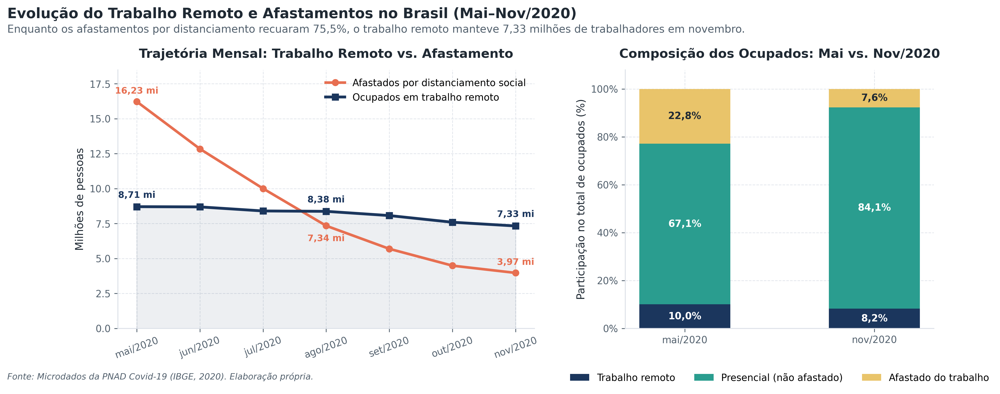
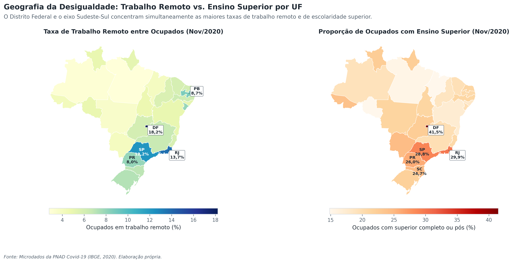
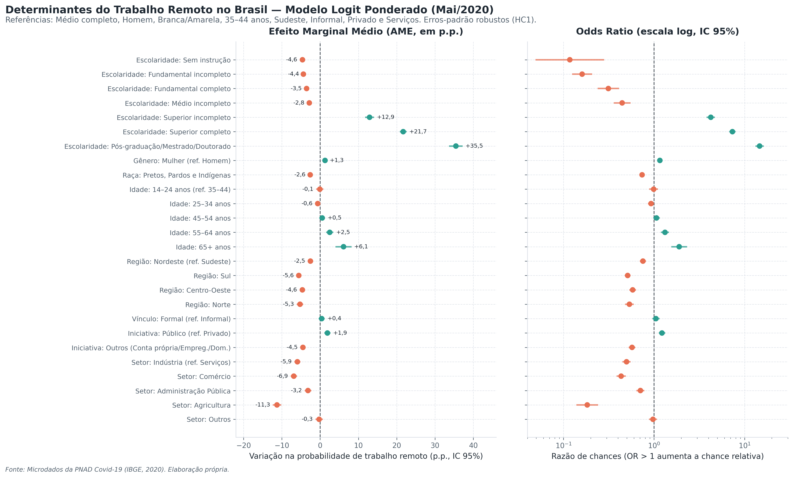
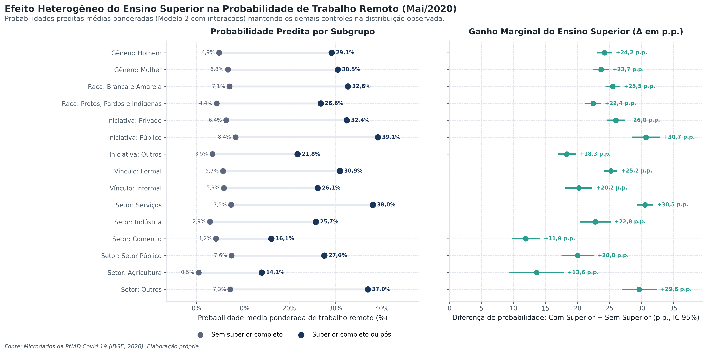

# Ensino Superior e Trabalho Remoto no Brasil (PNAD Covid-19, 2020)
# Higher Education and Remote Work in Brazil (PNAD Covid-19, 2020)


-5C677D)


> **[Versão em Português](#português)** | **[English Version](#english)**
>
> Projeto de portfólio em **Economia Aplicada e Ciência de Dados** originado da monografia de graduação em Ciências Econômicas pela **Universidade Federal do Paraná (UFPR)**, reestruturado com engenharia de dados modular, rigor econométrico (pesos amostrais, erros-padrão robustos `HC1`, efeitos marginais médios e validação temporal) e testes automatizados.

---

## Português

### 1. Visão Geral e Pergunta de Pesquisa

A pandemia da COVID-19 acelerou drasticamente a adoção do trabalho remoto no Brasil, expondo desigualdades estruturais no mercado de trabalho. Este estudo utiliza os microdados mensais da **PNAD Covid-19 (IBGE)** de maio a novembro de 2020 (**2.650.459 entrevistas**) para responder:

> **Como o ensino superior condiciona a probabilidade de trabalho remoto no Brasil e de que forma esse efeito interage com gênero, cor/raça, vínculo formal, iniciativa (pública vs. privada) e setor de atividade?**

---

### 2. Principais Achados

- **Resiliência do trabalho remoto após a reabertura:** Entre maio e novembro de 2020, o contingente de trabalhadores afastados por distanciamento social caiu **75,5%** (de 16,23 milhões para 3,97 milhões), enquanto o trabalho remoto manteve **7,33 milhões** de ocupados em novembro (8,2% dos ocupados totais), após pico de **8,71 milhões** em maio.
- **Forte concentração educacional:** Em novembro/2020, **76,0%** de todos os trabalhadores remotos possuíam ensino superior completo (**50,5%**) ou pós-graduação, mestrado ou doutorado (**25,4%**). Entre ocupados não afastados, a taxa de trabalho remoto atingiu **52,4% em maio (40,6% em novembro)** para pós-graduados contra apenas **5,0% (2,8%)** no ensino médio completo.
- **Desigualdade geográfica e sociodemográfica:** A região **Sudeste** concentrou **58,3%** dos trabalhadores remotos em novembro (**São Paulo** com 35,3%, **Rio de Janeiro** com 13,1% e **Minas Gerais** com 8,5%). Em incidência interna, o **Distrito Federal** liderou o país (**18,2%** dos ocupados em trabalho remoto e **41,5%** com ensino superior completo ou pós). As **mulheres** representaram **57,8%** do total remoto em novembro.
- **Efeito direto do ensino superior (Modelo Logit 1, Maio/2020):** Controlando simultaneamente por gênero, raça, idade, região, formalidade, iniciativa e setor, possuir **Superior completo** eleva a probabilidade média de trabalho remoto em **+21,7 p.p.** (OR = **7,34**; IC 95% [6,76; 7,97]) e **Pós-graduação** em **+35,5 p.p.** (OR = **14,65**; IC 95% [13,19; 16,28]) frente ao ensino médio completo.
- **Efeitos heterogêneos e interações (Modelo Logit 2):**
  - **Raça:** O termo `Superior × Pretos, Pardos e Indígenas` é positivo e significativo (OR = **1,254**, *p* = 0,0002), reduzindo a razão relativa de desigualdade racial (probabilidade predita sobe de **4,4% para 26,8%** entre PPI vs. **7,1% para 32,6%** entre Brancos/Amarelos).
  - **Setores físicos:** Na **Agricultura** (`Superior × Agricultura`, OR = **4,308**), o ensino superior eleva a probabilidade predita de **0,5% para 14,1%**; na **Indústria** (OR = **1,480**), de **2,9% para 25,7%** (+22,8 p.p.).
  - **Vínculo formal:** A complementaridade `Superior × Formal` (OR = **1,346**, *p* = 0,0011) gera ganho adicional de **+25,2 p.p.** no setor formal contra **+20,2 p.p.** no informal.
- **Robustez temporal (Maio vs. Novembro/2020):** Os modelos atingem **ROC-AUC ponderado de 0,869 (mai) e 0,881 (nov)** e **Pseudo-$R^2$ de McFadden de 0,295–0,301**. Enquanto os efeitos de escolaridade e raça permanecem estáveis, a **Iniciativa Pública** salta de OR = **1,22** (+1,9 p.p.) em maio para OR = **1,97** (+5,2 p.p.) em novembro, refletindo o retorno presencial mais rápido no setor privado.

---

### 3. Visualizações-Chave

| Evolução Temporal (Mai–Nov/2020) | Geografia: Trabalho Remoto vs. Ensino Superior |
| :---: | :---: |
|  |  |

| Efeitos Marginais e Odds Ratios (Modelo 1) | Efeito Heterogêneo do Ensino Superior (Modelo 2) |
| :---: | :---: |
|  |  |

<details>
<summary>Ver lista completa das 9 figuras geradas em <code>reports/figures/</code></summary>

1. `01_evolucao_ocupados_remoto.png` — Trajetória mensal de remotos vs. afastados e composição dos ocupados.
2. `02_perfil_genero_raca_idade.png` — Composição e taxa interna por gênero, raça e faixa etária.
3. `03_escolaridade_trabalho_remoto.png` — Concentração educacional dos remotos e taxa interna por escolaridade.
4. `04_mapa_remoto_e_superior_uf.png` — Mapas coropléticos comparando taxa de remoto e ensino superior nas 27 UFs.
5. `05_ocupacao_iniciativa_formalidade_setor.png` — Dinâmica por iniciativa, vínculo formal/informal e setor econômico.
6. `06_escolaridade_por_genero_e_setor.png` — Cruzamento de escolaridade por gênero e distribuição setorial.
7. `07_logit_efeitos_marginais_or.png` — *Forest plot* duplo de Efeitos Marginais Médios (AME em p.p.) e *Odds Ratios* (Mai/2020).
8. `08_interacao_ensino_superior.png` — Probabilidades preditas por subgrupo (*sem* vs. *com* superior) e ganho marginal ($\Delta$ p.p.).
9. `09_diagnosticos_e_robustez_mai_nov.png` — Curva ROC ponderada, calibração por decis e estabilidade dos *Odds Ratios* (Mai vs. Nov/2020).

</details>

---

### 4. Metodologia e Rigor Econométrico

1. **Universo amostral fiel ao questionário do IBGE:** Na PNAD Covid-19, a pergunta de trabalho remoto (`C013`) é aplicada apenas a quem não trabalhou no local habitual (`C012 == 'Não'`). Ocupados que permaneceram no local habitual (`C012 == 'Sim'`) possuem `C013` nulo por regra de salto e correspondem a trabalho presencial (`trabalho_remoto = 0`). Incluir todo o universo de ocupados não afastados no mercado de trabalho evita viés de seleção (`n = 106.686` em maio; `n = 137.621` em novembro).
2. **Ponderação e inferência robusta:** Os modelos Logit são estimados via `statsmodels.api.GLM` (família Binomial) com pesos amostrais `V1032` normalizados em `var_weights` e matriz de covariância robusta `HC1`.
3. **Interpretação correta de efeitos não lineares e interações:** Reportamos conjuntamente *Odds Ratios*, **Efeitos Marginais Médios (AME em p.p.)** discretos respeitando a exclusividade mútua entre níveis categóricos e, para o modelo com interações (Ai & Norton, 2003), **probabilidades preditas médias ponderadas** por subgrupo com intervalos de confiança de 95% via método delta.
4. **Diagnósticos completos:** Verificação de colinearidade (`VIF` máximo = 2,05), curva ROC ponderada, Brier Score, calibração por decis e validação cruzada temporal (maio vs. novembro).

---

### 5. Estrutura do Repositório

```text
COVID-Trabalho-Remoto/
├── data/
│   ├── raw/
│   │   └── pnad_covid_2020.parquet         # Microdados compactos (18 cols, 2,65M linhas, zstd ~20,5 MB)
│   └── processed/                          # Gerado localmente pelo notebook 01 (ignorado no Git)
├── notebooks/
│   ├── 01_preparacao_dados.ipynb           # Auditoria de saltos IBGE, limpeza vetorizada e validação
│   ├── 02_analise_descritiva.ipynb         # Panorama descritivo ponderado e mapas via geobr
│   └── 03_modelagem_logit.ipynb            # Modelos Logit, AMEs, interações, ROC/calibração e robustez
├── reports/
│   └── figures/                            # 9 figuras editoriais em alta resolução (300 DPI)
├── src/
│   ├── __init__.py
│   ├── config.py                           # Caminhos, mapeamentos geográficos, paleta e dicionário
│   ├── data_processing.py                  # Pipeline vetorizado de limpeza e validação
│   ├── descriptive.py                      # Tabelas cruzadas e agregações ponderadas
│   ├── modeling.py                         # Logit GLM ponderado, AME (delta method), previsões e VIF
│   └── visualization.py                    # Padronização visual e mapas coropléticos (geobr)
├── tests/
│   └── test_data_processing.py             # Testes unitários e de integridade (pytest)
├── pyproject.toml
├── requirements.txt
└── README.md
```

---

### 6. Como Reproduzir

```bash
# 1. Clonar o repositório
git clone https://github.com/msbrasil/COVID-Trabalho-Remoto.git
cd COVID-Trabalho-Remoto

# 2. Criar ambiente virtual e instalar dependências
python -m venv .venv
# Windows (PowerShell): .venv\Scripts\Activate.ps1 | Linux/macOS: source .venv/bin/activate
pip install -r requirements.txt

# 3. Rodar a suíte de testes automatizados
python -m pytest -v

# 4. (Opcional) Reexecutar os notebooks em ordem
python -m nbconvert --to notebook --execute --inplace notebooks/01_preparacao_dados.ipynb
python -m nbconvert --to notebook --execute --inplace notebooks/02_analise_descritiva.ipynb
python -m nbconvert --to notebook --execute --inplace notebooks/03_modelagem_logit.ipynb
```

---

## English

### 1. Overview and Research Question

The COVID-19 pandemic triggered an unprecedented shift toward remote work in Brazil, exposing deep socio-economic and occupational inequalities. Using microdata from the Brazilian Institute of Geography and Statistics (**IBGE — PNAD Covid-19**, May–November 2020; **2,650,459 observations**), this project examines:

> **How does higher education shape the likelihood of remote work in Brazil, and how does this educational premium interact with gender, race, job formality, public vs. private sector, and industry?**

### 2. Key Findings

- **Remote work persistence vs. social-distancing furloughs:** Between May and November 2020, workers away from work due to social distancing dropped by **75.5%** (16.23M to 3.97M), whereas remote workers declined modestly from **8.71M** (May) to **7.33M** (November, 8.2% of total employment).
- **Concentration at the top of education:** In November 2020, **76.0%** of all remote workers held a bachelor's (**50.5%**) or graduate degree (**25.4%**). Among active non-furloughed workers, remote-work incidence reached **52.4% in May (40.6% in November)** for postgraduates versus **5.0% (2.8%)** for completed high school.
- **Geographic and demographic concentration:** The **Southeast** region accounted for **58.3%** of remote workers in November (**São Paulo** 35.3%, **Rio de Janeiro** 13.1%, **Minas Gerais** 8.5%). The **Federal District (DF)** led internal incidence (**18.2%** of employed workers remote; **41.5%** with higher education). **Women** made up **57.8%** of remote workers.
- **Direct effect of education (Model 1, May 2020):** Controlling for demographics, region, formality, public/private status, and sector, holding a **bachelor's degree** increases remote-work probability by **+21.7 p.p.** (OR = **7.34**, 95% CI [6.76, 7.97]) and a **graduate degree** by **+35.5 p.p.** (OR = **14.65**, 95% CI [13.19, 16.28]) relative to completed high school.
- **Heterogeneous effects via interactions (Model 2):**
  - **Race:** `Higher Education × Black/Brown/Indigenous (PPI)` is positive and statistically significant (OR = **1.254**, *p* = 0.0002), narrowing the relative racial gap (predicted probability rises from **4.4% to 26.8%** for PPI vs. **7.1% to 32.6%** for White/Asian workers).
  - **Physical-intensive sectors:** Higher education multiplies relative odds in **Agriculture** (OR = **4.308**, raising predicted remote probability from **0.5% to 14.1%**) and **Manufacturing/Industry** (OR = **1.480**, **2.9% to 25.7%**).
  - **Job formality:** Formal workers exhibit a larger higher-education gain (**+25.2 p.p.** vs. **+20.2 p.p.** for informal workers; interaction OR = **1.346**, *p* = 0.0011).
- **Temporal robustness (May vs. November 2020):** Weighted models achieve **ROC-AUC = 0.869 (May) and 0.881 (Nov)** and **McFadden Pseudo-$R^2$ = 0.295–0.301**. While education and racial gradients remain stable, **Public-sector employment** jumps from OR = **1.22** (+1.9 p.p.) in May to OR = **1.97** (+5.2 p.p.) in November as private firms returned to on-site work faster.

### 3. Econometric Methodology

- **Survey skip-pattern integrity:** In PNAD Covid-19, remote-work question `C013` is asked exclusively to workers not working at their usual workplace (`C012 == 'No'`). Workers remaining at their usual workplace (`C012 == 'Yes'`) are coded as on-site (`trabalho_remoto = 0`) rather than dropped, preventing selection bias across the full active employed universe (`n = 106,686` in May; `n = 137,621` in November).
- **Survey weights & robust inference:** Estimated via Binomial GLM (`statsmodels`) with normalized survey weights (`V1032`) as `var_weights` and heteroskedasticity-robust `HC1` standard errors.
- **Non-linear interaction interpretation:** Reports *Odds Ratios*, mutually-exclusive categorical **Average Marginal Effects (AME in p.p.)**, and G-computation **subgroup average predicted probabilities** with delta-method 95% confidence intervals (Ai & Norton, 2003), alongside VIF checks (max = 2.05), weighted ROC curves, and decile calibration.

### 4. Reproducing Locally

```bash
git clone https://github.com/msbrasil/COVID-Trabalho-Remoto.git
cd COVID-Trabalho-Remoto
python -m venv .venv
pip install -r requirements.txt
python -m pytest -v
```

---

### Fonte dos Dados e Referências / Data Source & References

- **IBGE — Pesquisa Nacional por Amostra de Domicílios: PNAD Covid-19** (Maio–Novembro de 2020).
- Ai, C., & Norton, E. C. (2003). Interaction terms in logit and probit models. *Economics Letters*, 80(1), 123–129.
- Barbosa Filho, F., Veloso, F., & Peruchetti, P. (2021). *Trabalho Remoto no Brasil*. FGV IBRE.
- Delaporte, I., & Peña, W. (2020). Working from home under COVID-19: who is affected? Evidence from Latin American and Caribbean countries. *Covid Economics*.
- Dingel, J. I., & Neiman, B. (2020). How many jobs can be done at home? *Journal of Public Economics*, 189, 104235.
- Góes, G., Martins, F., & Nascimento, J. (2020a, 2020b). *Potencial de Teletrabalho na Pandemia* & *Teletrabalho na Pandemia: Efetivo versus Potencial*. Cartas de Conjuntura nº 47 e nº 48, IPEA.
- Saltiel, F. (2020). Who can work from home in developing countries? *Covid Economics*, 6, 104–118.
